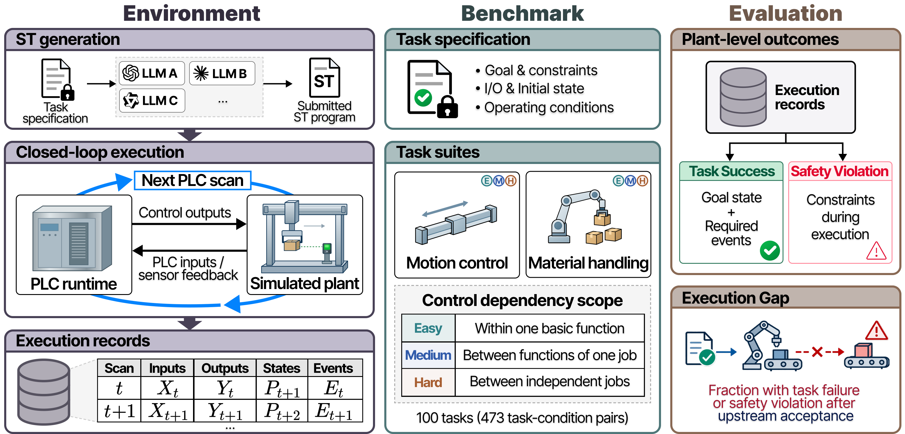

# PLCWorld: Benchmarking LLM-Generated PLC Programs in Closed-Loop Plant Simulation

[](https://arxiv.org/abs/2610.02982)
[](https://yunji0516.github.io/PLCWorld/)
[](https://github.com/yunji0516/PLCWorld)

Code, task specifications, saved programs, evaluation records, and an interactive
3D replay viewer for **PLCWorld**.

## Overview

A PLC program can pass an upstream code check and still fail when it controls a
plant. PLCWorld evaluates generated Structured Text (ST) programs in a closed
loop: the PLC issues commands, the plant changes state, and sensors return the
inputs for the next scan.

[](assets/framework.pdf)

The benchmark measures **Task Success** and **Safety Violation** separately.
The **Execution Gap** captures task failure or a safety violation among cases
whose programs pass the upstream check.

## Highlights

- **100 tasks and 473 registered conditions.** Motion Control and Material Handling
  tasks span three levels of control dependency: Easy, Medium, and Hard.
- **Closed-loop plant execution.** Commands, device motion, workpiece states, and
  sensor feedback interact over repeated PLC scans.
- **Saved programs and case-level evidence.** The release includes 1,777 ST programs
  across 1,800 submission slots for six models and three repetitions. The 23 missing
  programs are recorded generation failures and remain in the denominator.
- **Inspect execution in 3D.** Browse reference recordings for all 100 tasks, inspect
  devices and recorded results, and replay newly evaluated programs through **My runs**.

## Released artifacts

| Artifact | Path | Contents |
| --- | --- | --- |
| Evaluator | `evaluator/` | ST execution, plant dynamics, and task-success and safety checks |
| Model inputs | `inputs/` | Task specifications and the execution contract for new generation |
| Saved submissions | `submissions/` | ST programs, partial failed outputs, and the generation-failure inventory |
| Evaluation records | `results/`, `outputs/reproduction/` | Result summaries and saved case-level records |
| Replay viewer | `viewer3d/`, `replay/` | 3D renderer, display recordings, and geometry |
| Archived raw traces | `replay/traces/` | Reference, selected paper-example, and diagnostic recordings with source manifests |
| Verification | `verification/`, `scripts/`, `tests/` | File integrity, source commitments, reproduction tools, and tests |
| Paper figure | `assets/framework.pdf` | Framework figure used in the manuscript |
| Project website | `docs/` | Static website, figures, and task videos |

## Quick start

There is one 3D viewer, with two ways to run it. Choose either Docker or native
execution; you do not need to start both. Native execution listens on port 3200.
Docker Compose maps the same viewer's container port 3200 to host port 3201.

### With Docker

Install Docker with Docker Compose, then run from the repository root:

```bash
docker compose build evaluator viewer3d
docker compose run --rm evaluator
docker compose up viewer3d
```

The default evaluator command verifies the package, constructs all 473 plant
conditions, checks all 100 input bindings, and evaluates one saved program.
It requires no model API key.

Open [the replay viewer](http://localhost:3201/replay?task=MOT-E01).

### Without Docker

Install Python 3.11+ and a supported Node.js LTS release (20.19+, 22.12+, or 24+), then run:

```bash
python3 scripts/smoke.py
```

Start the viewer in another terminal:

```bash
cd viewer3d
npm ci
npm run build
npm run start --workspace @plcworld/replay-3d
```

Open [the native replay viewer](http://localhost:3200/replay?task=MOT-E01).
For native evaluation, omit `docker compose run --rm evaluator` from the commands below.

## Evaluate your own ST program

Save a program as `outputs/program.st`, then run:

```bash
docker compose run --rm evaluator python3 evaluator/evaluate.py \
  MAT-E01 outputs/program.st --output outputs/my-evaluation --keep-traces
```

Scores and compressed raw scan traces are written to `outputs/my-evaluation/`.
Choose a new output directory for each evaluation. See [the replay guide](replay/README.md)
for converting generated traces into viewer recordings.

## Re-evaluate saved submissions

These commands evaluate saved programs without new model API calls:

```bash
docker compose run --rm evaluator python3 scripts/reproduce.py \
  --model gpt-5.5 --repeat 1 --task MAT-E01 --output outputs/example

docker compose run --rm evaluator python3 scripts/reproduce.py \
  --model claude-sonnet-5 --repeat 1 --output outputs/claude-r01 --jobs 4
```

Output directories must be new; use `--resume` to continue an interrupted run.
The six models are GPT-5.5, GPT-4o, Claude Sonnet 5, Gemini 3.1 Pro,
Gemini 3.8 Flash, and Qwen3.5-Plus.

Compare saved evaluation records with the paper result manifest:

```bash
docker compose run --rm evaluator python3 scripts/verify_paper_results.py \
  --root outputs/reproduction/ --output outputs/verification/paper-comparison.json
```

This comparison checks saved records; it does not rerun the experiments.
Summary results for the four adapted methods are included in `results/`;
code for rerunning those methods is not included. Their adaptations and
experimental protocols are described in the paper.

## Generate a new program

New generation makes one paid OpenAI API request and requires an API key.
Choose a model ID available to your account. In Bash or Zsh:

```bash
export OPENAI_API_KEY="your-key"
docker compose run --rm -e OPENAI_API_KEY evaluator \
  python3 scripts/generate_once.py --task MOT-E01 --model gpt-5.5
```

In PowerShell, set the key with `$env:OPENAI_API_KEY = "your-key"`.
Use `--dry-run` to check inputs without an API request, or `--scenario 0`
to evaluate only the first condition.

Results and raw traces are saved under `outputs/generated/`. After successful
replay adaptation, refresh the viewer and select **My runs**. A rejected program
with no executable trace has no replay link. New stochastic generations are
not expected to reproduce saved programs.

## Inspect a replay

- **Front, Side, Top, Reset view:** select a camera view.
- **Device labels and selection:** click equipment to highlight it and inspect its
  name, recorded state, and linked I/O. Click again or use Clear selection to deselect.
- **Status:** inspect process, device, workpiece, and current-violation readings.
- **Execution result:** view recorded PASS/FAIL for the selected run and condition.
  View failure seeks to the violation or, for a missed goal, the end of the run.
- **Troubleshooting:** reload the 3D scene and inspect local diagnostics.

A replay result refers to one run and condition, not an aggregate verdict across
all conditions. Appearance geometry visualizes recorded execution; it does not
execute ST or recompute benchmark scores.

## Verification and reproducibility

The release retains case-level evaluation records and source hashes linking
reported results to their corresponding artifacts. `artifact.json` identifies
the bundled runtime and inputs and pins the file inventory.

```bash
python3 scripts/verify.py
python3 -m unittest discover -s tests
```

- `verification/equivalence.json` records sampled comparisons between the packaged
  runtime and the measured implementation; it is not a claim that every earlier
  evaluator version is behaviorally equivalent.
- `verification/source-results.json` retains source hashes for imported paper records.
  Public records normalize paths and packaging metadata while preserving judgments,
  original program hashes, and trace hashes.
- `submissions/failed/gemini-3.8-flash/` contains 23 partial ST outputs whose
  generation stopped at the token limit (`incomplete_MAX_TOKENS`). These are
  generation failures, not complete programs that failed during plant execution.
  They are retained as evidence and remain in the evaluation denominator; they
  are not executed as complete submissions. `submissions/manifest.json` records
  each affected task, repetition, failure reason, and partial-source hash.
- Archived raw recordings are included in `replay/traces/reference/`,
  `replay/traces/paper-samples/`, and `replay/traces/fixtures/`. They retain their
  source evaluator metadata and are not new evaluations with the bundled runtime.
  New evaluations can also generate raw traces locally. Paper scores come from
  the bundled case-level evaluation records.
- The execution contract covers scan-clock TON timing, millisecond conversions,
  checked INT/DINT ranges, and external sensor saturation. See
  [the model instructions](inputs/system-instructions.txt) for the complete rules.

## Citation

If you use PLCWorld in your research, please cite the preprint:

```bibtex
@misc{kim2026plcworld,
  title         = {PLCWorld: Benchmarking LLM-Generated PLC Programs in Closed-Loop Plant Simulation},
  author        = {Kim, Yunji and Lee, Yunseok and Seo, Hyunwoo and Choi, Jaerim and Lee, Woojin},
  year          = {2026},
  eprint        = {2610.02982},
  archivePrefix = {arXiv},
  primaryClass  = {cs.AI},
  url           = {https://arxiv.org/abs/2610.02982}
}
```
